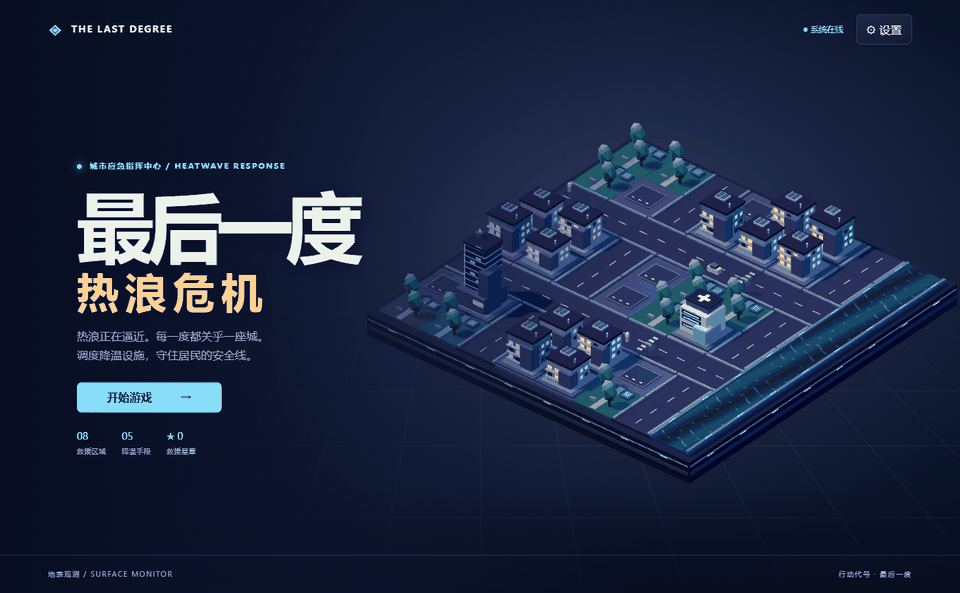
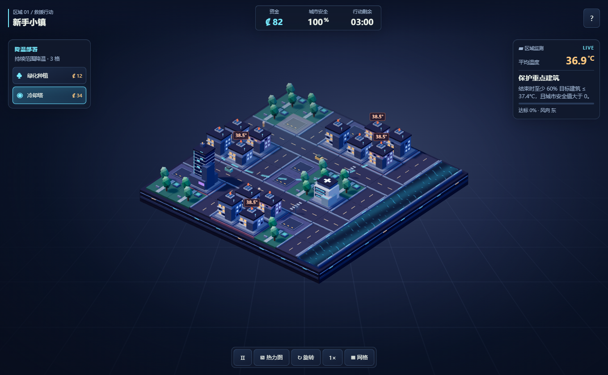
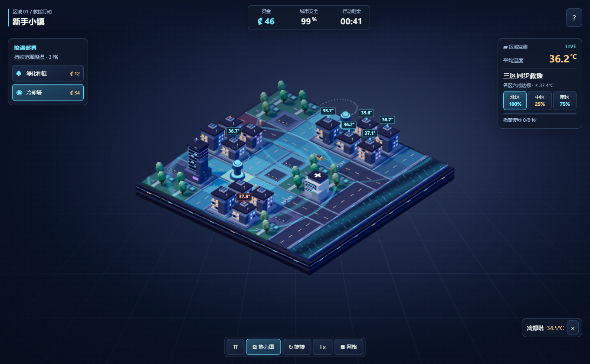

<div align="center">

<h1>The Last Degree: Heatwave Crisis</h1>
<p><strong>A playable 3D city rescue strategy game.</strong></p>
<p>Deploy cooling infrastructure, watch temperatures fall, and evacuate before the heat wave overwhelms the city.</p>

<p>


</p>

<p><a href="README.md">English</a> · <a href="README.zh-CN.md">简体中文</a></p>
<p><a href="docs/images/demo.gif"><strong>Watch the gameplay demo</strong></a></p>

<p><sub>Captured from the running game in Microsoft Edge. Deployment → visible temperature changes → evacuation.</sub></p>

</div>

---

**[Gameplay](#gameplay)** · **[Engineering](#engineering)** · **[Quick start](#quick-start)** · **[Verification](#verification)** · **[Privacy](#privacy)** · **[Visual review](docs/VISUAL_REVIEW.md)**

## Gameplay

The opening town is a **55-second rescue drill**. Spend the budget immediately and get at least 60% of the homes in **each** of three sectors below the safety threshold. Keep all three stable for eight simulated seconds to win early. Select a sector on the HUD to locate its homes.

Seven later maps introduce industrial hot spots, hospitals, budget constraints and forecast events. Trees, cooling towers, wind guides, mist systems and rain offer different costs and areas of effect. Best scores and unlocked levels are saved in the current browser.

| Before deployment | Cooling response |
| --- | --- |
|  |  |

[Heat map](artifacts/heatmap.png) · [Mobile layout](artifacts/mobile.png) · [Rain in the final district](artifacts/rain.png) · [Victory screen](artifacts/victory.png)

## Engineering

| Component | Implementation |
| --- | --- |
| Simulation | Seeded, fixed-step TypeScript model. Cell temperatures combine diffusion, environmental heating and distance-weighted cooling with wind offsets. |
| Rendering | Procedural Three.js architecture, instanced geometry, water and cooling shaders, and projected temperature labels. Rendering and simulation use separate clocks. |
| Interaction | Raycast placement and preview, mouse orbit and zoom, touch confirmation and a precision grid. |
| Offline | Vite builds a static PWA. The generated service worker precaches versioned assets. The game runs locally after the first successful cache. |
| Numerical reference | FastAPI, Pydantic and NumPy expose reproducible temperature simulations and comparisons. Cross-language tests compare field values. |

[Visual review and measured software-renderer frame intervals](docs/VISUAL_REVIEW.md) · [API reference](docs/API.md)

## Quick start

Use Node.js 24 and pnpm 11.25.

```sh
pnpm install --frozen-lockfile
pnpm build
pnpm preview
```

Open [the local preview](http://127.0.0.1:4173/). On Windows, double-click **Launch Game.cmd** after building to start on port 4188 with Python 3, and double-click **Stop.bat** to stop the same launcher.

Choose **开始游戏**, then **新手小镇**. Hover a buildable tile to preview the area, click to build, or tap twice on a touchscreen. The bottom bar controls pause, heat map, rotation, speed and the placement grid.

## Verification

The production build and local checks passed with **15 Vitest tests, 4 pytest tests and 3 Edge end-to-end tests**. Coverage includes an early clear, a lost run with uneven sector coverage, later district rendering, rain, browser save recovery, and offline touch deployment. A separate launcher smoke test verified that `Stop.bat` releases port 4188.

```sh
pnpm test
python -m pytest -q
pnpm build
pnpm test:e2e
```

Install [the Python dependencies](backend/requirements.txt) for pytest and set `SIM_PYTHON` to that interpreter to enable the numerical parity test. GitHub workflows are manually triggered. Native installer configuration is retained in the [Chinese guide](README.zh-CN.md).

## Privacy

The game uses browser-local storage for progress and settings. The launcher binds to loopback and serves `dist/`. The demo uses a clean browser session and records the game viewport only. The stop capability is generated per launcher run and stored in a local ignored file.

[MIT License](LICENSE) · [Changelog](CHANGELOG.md) · [中文技术文章草稿](docs/CSDN.md) · [Known issues](ISSUES.md)
