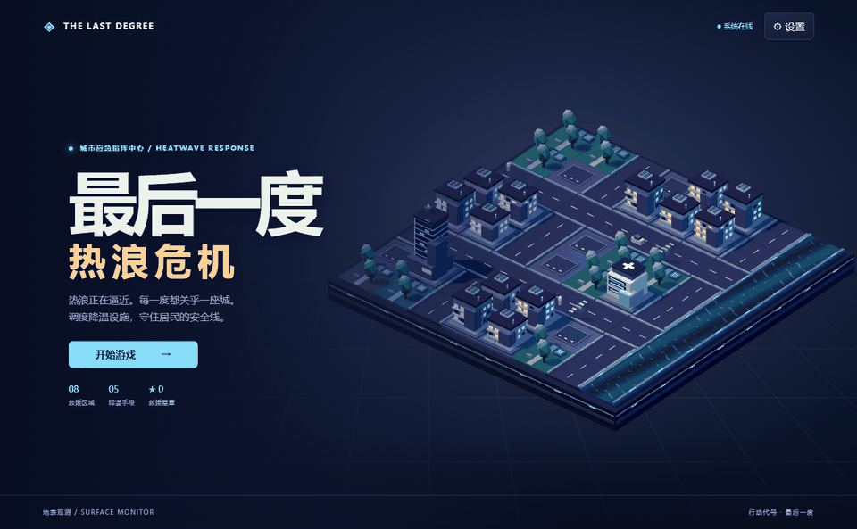
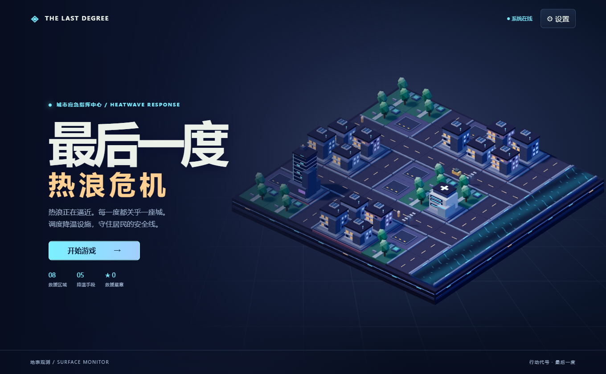
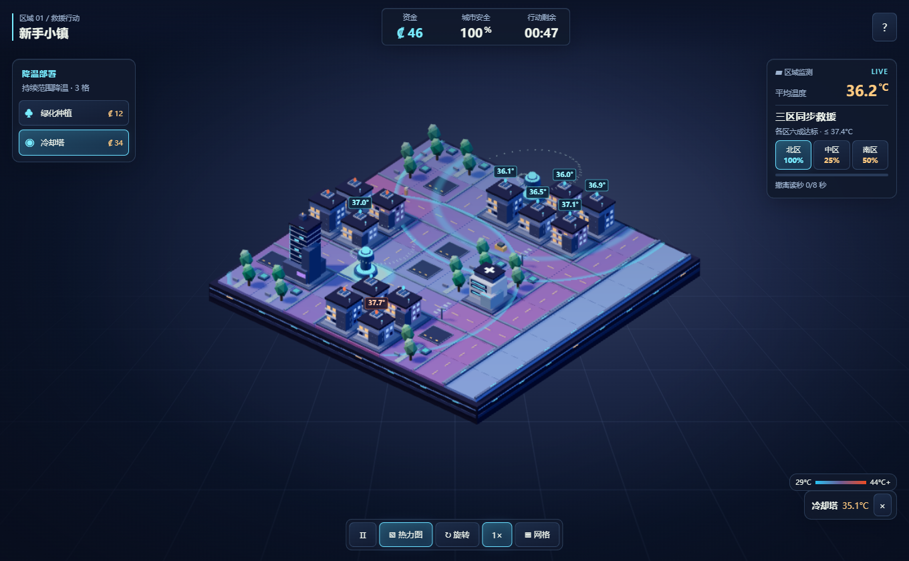

<div align="center">

<h1>最后一度：热浪危机</h1>
<p><strong>在热浪压垮城市之前，把三个街区一起拉回安全线。</strong></p>
<p><a href="README.md">English</a> · <a href="README.zh-CN.md">简体中文</a></p>
<p></p>
<p><sub>实际运行画面 · 地块部署 → 温度下降 → 三个街区达标 → 提前撤离</sub></p>

</div>

**The Last Degree: Heatwave Crisis** · 3D 微缩城市救援策略游戏

你是城市降温指挥官。新手小镇是一场 55 秒限时救援。开局即发放全部资金，每个街区至少六成目标建筑达标且同时保持 8 秒，即可提前撤离。后七关在计时结束时按全关达标率与城市安全值结算。





[查看 Edge 手机视口触屏截图](artifacts/mobile.png)

## 在 Windows 上游玩

运行 `pnpm build` 生成 `dist/` 后双击 **Start.bat** 即可用系统默认浏览器启动，需要 Python 3 提供本地静态文件服务。固定地址为 `http://127.0.0.1:4188/`，重启后沿用该地址的存档。双击 **Stop.bat** 或关闭启动窗口可结束服务。关闭浏览器标签页后，本地服务仍可供下次打开使用。网页和原生壳的游戏逻辑均在本地运行，静态启动器仅使用 Python 标准库。

从源码构建需要 Node.js 24 和 pnpm 11.25。缺少 pnpm 时可用 Node.js 随附的 npm 运行 `npm install -g pnpm@11.25.0`。

```powershell
pnpm install --frozen-lockfile
pnpm dev
```

打开 [开发服务器](http://127.0.0.1:5173)。正式构建和预览使用 `pnpm build`、`pnpm preview`，预览地址为 [本地正式版](http://127.0.0.1:4173)。

## 操作

- 点击城市建筑查看温度。橙色标记对应超温重点建筑。点击 **热力图** 查看分布和达标标记。
- 选择设施后点击街道、空地或公园。鼠标悬停可预览覆盖范围。触屏先点地图预览，再点同一格确认。同一格只能部署一处设施，**网格** 可用于精确选格。
- 鼠标拖动或单指滑动旋转。滚轮或双指缩放。底部 **旋转** 按钮每次转动 45°。
- 点击速度按钮切换 1×、2×、4×。按 Esc 或 HUD 暂停键暂停。
- 后续关卡逐步开放设施。行动前 12 个游戏秒出现事件预警。完成关卡解锁下一关，最佳星数与设置保存在当前浏览器或应用内。重开会重用当前关卡事件种子。

| 设施 | 费用 | 效果 |
| --- | ---: | --- |
| 绿化种植 | 12 | 半径约 2 格的持续冷却 |
| 冷却塔 | 34 | 半径约 3 格，冷却中心随风偏移 |
| 风向引导器 | 16 | 影响 2 格内的设施，把塔和喷雾的冷却中心推向指定方向 |
| 喷雾系统 | 21 | 半径约 3 格，强化冷却 42 秒，随后释放地块 |
| 人工降雨 | 25 | 全城冷却 24 秒，部署后 66 秒可再次使用 |

| 区域 | 挑战 | 游戏时间 |
| --- | --- | ---: |
| 新手小镇 | 三个街区同步降温，稳定后提前撤离 | 最多 0:55 |
| 炎热商业街 | 三段商业区分散部署 | 3:15 |
| 工业热源 | 工厂高温与住宅覆盖 | 3:25 |
| 医院保卫战 | 三处医院、严格温度线 | 3:35 |
| 干旱城市 | 无河流，启动资金和补给受限 | 3:45 |
| 热浪突袭 | 高频事件，开放人工降雨 | 3:55 |
| 城市连锁危机 | 工厂、商业楼和医院同时纳入监控 | 4:10 |
| 终极热浪 | 更高基础温度和密集事件 | 4:30 |

通关得到一星。保留至少 55% 的初始安全值可得第二星，保留至少 82% 且达标率达到 85% 可得第三星。

## 技术结构

- `src/` 包含 React UI、Three.js 程序化城市、Web Audio、战役和 TypeScript 固定步长模拟。
- `src/rules.json` 是温度场基础参数的共用数据。
- `backend/` 提供 FastAPI、Pydantic 和 NumPy 参考计算。
- `android/` 与 `src-tauri/` 分别包含 Capacitor 和 Tauri 2 工程。
- `public/` 包含 PWA 清单和原创图标，构建时生成预缓存 Service Worker。
- 模型用于游戏平衡与策略对比，适用范围是本游戏定义的离散规则。

## 测试与 Python 接口

正式构建通过。Vitest 15 项、pytest 4 项、Edge 端到端 3 项通过。另实测 `Stop.bat` 能关闭本项目的启动器并释放 4188 端口。

```powershell
python -m venv .venv
$py = (Resolve-Path .venv/Scripts/python.exe).Path
& $py -m pip install -r backend/requirements.txt
& $py -m pytest -q
$env:SIM_PYTHON = $py
pnpm test
pnpm build
pnpm test:e2e
& $py -m uvicorn backend.main:app --host 127.0.0.1 --port 8000
```

Windows 本地 Playwright 使用 Edge。GitHub Actions 安装 Chromium。浏览 [交互式 API 文档](http://127.0.0.1:8000/docs) 或阅读 [接口说明](docs/API.md)。

## 构建 Windows 安装程序

准备 Rust stable、Cargo、带 Windows SDK 的 MSVC C++ Build Tools 和 WebView2，然后执行：

```powershell
pnpm exec tauri info
pnpm exec tauri build --bundles nsis
```

NSIS 产物目录为 `src-tauri/target/release/bundle/nsis/`。本机缺少 Rust/Cargo 和 MSVC，安装包尚未生成。桌面壳使用 TypeScript 模拟核心，Python 参考 API 可按需单独启动。[Tauri Windows 安装文档](https://v2.tauri.app/distribute/windows-installer/)

## 构建 Android 调试 APK

准备 JDK 21、Android Studio 与 SDK Platform 35，按 SDK 安装位置设置会话变量或 `android/local.properties`。

```powershell
pnpm build
pnpm exec cap sync android
Push-Location android
.\gradlew.bat assembleDebug
Pop-Location
```

产物预期位于 `android/app/build/outputs/apk/debug/app-debug.apk`。本机的 Capacitor 同步成功，Gradle 分发包下载超时，且未检测到 SDK。可以在具备环境的机器重跑，或在自己的仓库手动运行 **Build installers** 工作流。[Capacitor Android 文档](https://capacitorjs.com/docs/v7/android)

## GitHub Pages、iPhone 与离线

生产构建采用相对路径，可部署在仓库子路径。静态托管只需发布 `dist/`。仓库的测试、打包和 Pages 工作流均为手动触发。当前仓库为私有，演示随源码提供。

iPhone 用 Safari 打开 HTTPS 游戏地址，在分享菜单选择「添加到主屏幕」。首次在线进入并完成缓存后，同一地址支持离线打开。离线重载已在 Edge 手机视口验证，真实 iPhone 的安装体验待验证。

## 常见问题

- **空白页面**：通过本地启动器或 HTTP(S) 访问，直接打开 `dist/index.html` 会受浏览器模块策略限制。
- **没有声音**：先进行一次点击或触屏操作，再检查设置里的音量。
- **3D 较慢**：在设置中关闭高画质阴影。低帧率时渲染器也会逐步降低像素比。WebGL 不可用时可打开网格操作。
- **旧版本仍在运行**：关闭同一站点的所有页面后重新打开，让新 Service Worker 接管。
- **Python 一致性用例被跳过**：将 `SIM_PYTHON` 指向安装了参考模块依赖的 Python 解释器。

[English](README.md) · [更新记录](CHANGELOG.md) · [CSDN 草稿](docs/CSDN.md) · [已知事项](ISSUES.md)
