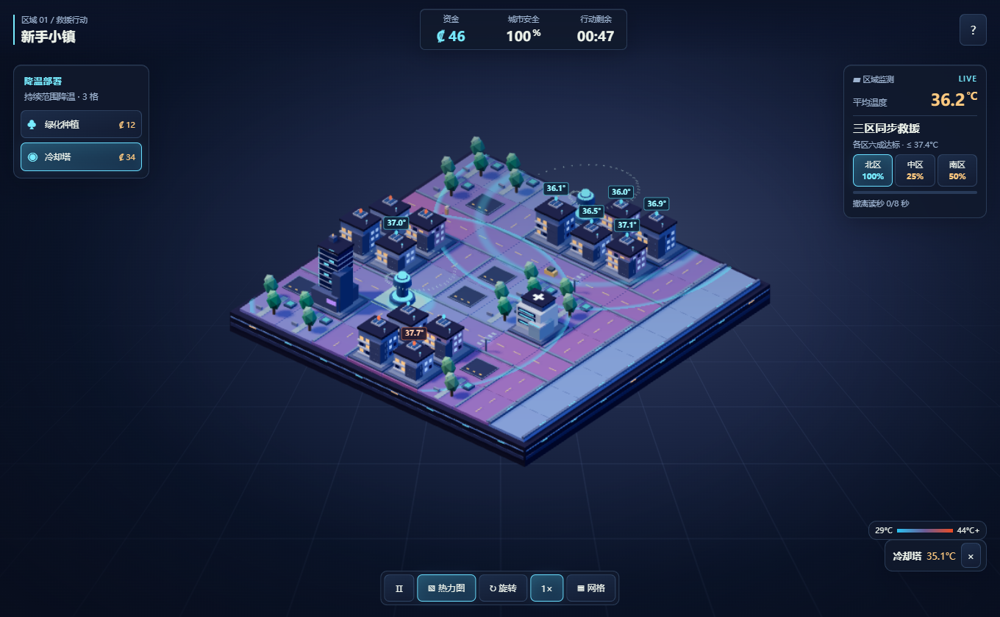

# 用 Three.js 和 NumPy 做一款热浪救援游戏：从固定步长到离线部署

一局《最后一度：热浪危机》从一笔建设资金开始。把所有冷却塔放在同一处，会让另一侧的住宅持续超温。工业区里的风向引导器则可以把附近设施的冷却中心推向厂房。让温度直接决定胜负以后，热力图就成了玩家的地图。



## 用程序化几何拼出微缩城市

地图以字符网格定义。相同的地块索引贯穿规则、绘制、射线拾取和网格面板。建筑墙面、屋顶、窗户、路面标记和树冠由几种共享几何体组合。静态部件按几何体归组，交给 Three.js 的 InstancedMesh，减少逐个提交小物件的开销。渲染与模拟使用各自时钟，摄像机和粒子连续运动，规则每次推进一秒。

温度图只在模拟状态或显示模式变化时更新地块实例颜色。橙色与绿色浮标表示重点建筑的温度状态，选中的地块可以单独查看数值。主线程在持续低帧率时降低渲染像素比，移动端默认关闭高画质阴影。

## 同步读取旧网格，逐步更新温度

对格子 i 计算目标温度 E。它包含地表偏差、昼间热量、水体邻接、设施冷却与事件影响。冷却塔和喷雾的中心受风偏移。之后用上一时刻的四邻域平均温度 M 更新：

```text
T_next[i] = T[i] + 0.16 × (E[i] − T[i]) + 0.12 × (M[i] − T[i])
```

边缘只计算地图内的邻居，单格地图的扩散项为零。暂停时不提交模拟步，加速只改变提交频率。重开复用同一事件种子，方便比较策略。上述参数描述的是离散游戏规则。

## 把模型变成游戏规则

八张地图分别更换重点建筑、财政补给、初始热量和事件密度。城市安全按超温暴露递减，结束时达标比例不足会失败。喷雾到期释放地块，人工降雨有充能时间。种植成本较低，长期有效。塔和喷雾结合定向引导时适合照顾上风侧部署够不到的建筑。

关卡回归比较空跑与有部署的路线。策略基准在有限的候选地块中比较短期超温暴露，给出每个固定种子的一条可重复通关路线。它是开发期测试工具。

## Python 如何复算网页温度

FastAPI 使用 Pydantic 校验网格尺寸、设施位置和事件时序。NumPy 切片累加四邻域，使用广播计算设施距离和区域事件。两套实现从同一份 JSON 读取基础参数。跨语言测试将同一场景送入两边，对比每步平均温度、末态每个格子的数值和风向。

## 网页离线、桌面壳与 Android 壳

Vite 构建一次，PWA、Tauri 和 Capacitor 共用同一套产物。Service Worker 使用内容哈希缓存构建资源。真实 Edge 离线重载曾暴露出首页命中缓存、脚本和样式未命中的问题。针对构建生成的同源静态资源按 URL 匹配缓存后，断网重载可以继续游戏。

本机验证了网页构建、PWA 缓存和 Capacitor 同步。Tauri 构建需要 Rust/Cargo 与 MSVC。Android 安装包需要 Android SDK 和可用的 Gradle 分发包。两种原生安装包的构建流程已提交到工程配置，当前机器尚未产出安装包。
